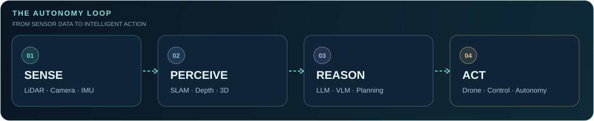

<!-- GitHub profile README: robotics, spatial perception and AI -->

  

  
  
   
  

## 👋 Hello, I'm Minh

I'm interested in **perception-driven autonomous systems** — robots that can **sense the physical world**, build useful spatial representations, and make intelligent decisions.

My co-authored research spans **3D LiDAR object detection, real-time robotic perception, and Vietnamese speech recognition**. I also work on **drones, robotics simulation, computer vision, and interactive 3D tools**, while exploring **SLAM, LLMs/VLMs for robotics, and quantum computing**.

> **Research direction:** bridging geometry, dynamics, visual perception, and learning-based reasoning for more robust autonomous robots.

## 📚 Research publications

  
  
  

### 📡 LiDAR & 3D perception · Journal articles

**2026 · Object detection / model distillation**  
**[Attention-Augmented Lightweight 3D LiDAR Object Detection for Rubber Trees via MobilePIXOR and Model Distillation](https://doi.org/10.1007/s13369-026-11720-1)**  
*Arabian Journal for Science and Engineering* · October 2026 · Co-author  
[**DOI ↗**](https://doi.org/10.1007/s13369-026-11720-1) `10.1007/s13369-026-11720-1`

**2025 · Multi-task robotic perception**  
**[Multi-Task Real-Time 3D LiDAR Perception with Attention-Enhanced MobilePIXOR for Obstacle Segmentation and Pedestrian Detection in Autonomous Robots](https://doi.org/10.1007/s13369-025-10568-1)**  
*Arabian Journal for Science and Engineering* · First published September 2025 · Co-author  
[**DOI ↗**](https://doi.org/10.1007/s13369-025-10568-1) `10.1007/s13369-025-10568-1`

> **Journal ranking:** *Arabian Journal for Science and Engineering* is **Q1 (SCImago / SJR 2025, Multidisciplinary)** and **Q2 (JCR / Web of Science 2025)**. Quartile rankings describe the **journal**, not the individual papers. [Journal ranking context](https://news.kfupm.edu.sa/news/ajse-keeps-gaining-momentum-after-50-years/361/).

### 🗣️ Speech AI · IEEE conference paper

**2026 · Vietnamese automatic speech recognition**  
**[Improving Vietnamese Speech Recognition Using Wav2Vec 2.0 with N-Gram Language Model and Beam Search](https://doi.org/10.1109/EEiSS69782.2026.11584547)**  
*2026 3rd International Conference on Electronic Engineering and Information Systems (EEiSS)* · IEEE · Co-author  
[**IEEE Xplore ↗**](https://ieeexplore.ieee.org/document/11584547) · [**DOI ↗**](https://doi.org/10.1109/EEiSS69782.2026.11584547)

See the full publication list on [ORCID](https://orcid.org/0009-0000-7433-1951).

---

## 🔭 Research interests

| Domain | Topics |
| :--- | :--- |
| 🤖 **Robotics & Autonomous Systems** | UAVs, robot dynamics, control, navigation, simulation |
| 📡 **LiDAR & 3D Perception** | Point clouds, SLAM, state estimation, sensor fusion |
| 👁️ **Computer Vision** | Depth estimation, detection, 3D reconstruction, scene understanding |
| 🧠 **LLMs / VLMs / Embodied AI** | Language-guided planning, multimodal reasoning, robot agents |
| ⚛️ **Quantum Computing** | Hybrid algorithms, quantum ML and optimization *(learning / exploratory)* |

## 🛰️ From sensors to autonomy

  

## 🚀 Selected projects

| Repository | What I'm building / exploring |
| :--- | :--- |
| 🚁 **[Drone-Navigation](https://github.com/biliz-nguyen/Drone-Navigation)** | Vision-guided drone navigation and distance-estimation experiments |
| 🛩️ **[Drone_Webots](https://github.com/biliz-nguyen/Drone_Webots)** | Drone simulation in Webots |
| 🪐 **[SPACE_LOT](https://github.com/biliz-nguyen/SPACE_LOT)** | Interactive 3D aerospace / design experiments |

  
<b>🧪 Ideas I'm currently exploring</b>

  - **LiDAR + vision:** point-cloud processing, maps, and sensor fusion for robots.
  - **Physics + learning:** combining physical models with visual observations.
  - **Embodied AI:** connecting VLM perception and LLM planning to robot actions.
  - **Quantum + ML:** small hybrid optimization and learning experiments.

  These are research interests, not claims that all the projects have already been implemented.

## 🧰 Tools & technologies

## 🔗 Find me

**[GitHub](https://github.com/biliz-nguyen)** · **[ORCID](https://orcid.org/0009-0000-7433-1951)**

  BUILD · EXPERIMENT · MEASURE · LEARN · REPEAT
   
  Made with curiosity, geometry, physics, and a rotating LiDAR scan ✦

